# Central Monitoring for SAWO INC.: User Documentation

*Read-only monitoring screen for the Odoo production, shipping and sales order data of **SAWO INC. only** (Lapu-Lapu City, Cebu, Philippines).*
*Status: development build, documented from the code on 22 October 2026 (version 3).*

---

## Overview

### What the system is for

Central Monitoring is a **wall-monitor dashboard**. It shows, on one screen, how production, shipping and sales
orders are going at **SAWO INC.**, without anyone having to open Odoo.

- **SAWO INC. only.** The dashboard reads the data of one company: **SAWO INC.** (Lapu-Lapu City, Cebu). Its five
  plants and warehouses (PL1, PL2, PL3, PL4, WH4) are all in Lapu-Lapu City. See [Which company the data comes from](#which-company-the-data-comes-from).
- **Read-only.** It only looks at Odoo data. It never creates, changes or deletes anything in Odoo.
- **Near-real-time, not instant.** A server program copies the data from Odoo on a schedule
  (sales orders about every minute, production and shipping about every 4–5 minutes).
  The screen asks that server for fresh numbers every 30 seconds.
- **Odoo is the source of data.** If a number looks wrong here, Odoo is where it is corrected.

### What changed in this version (since 19 October 2026)

| Area | Change |
|---|---|
| **CBM Shipped** | Counts **finished goods only** (heaters, sauna rooms, accessories, other finished goods). The plant table was replaced by a **monthly bar chart** of the last 12 months, split into Accessories / Heaters / Sauna Rooms / Other, with a table of the values underneath. The panel now uses the full width. |
| **Layout** | "Manufacturing CBM by Plant & Product Category" now sits directly below "Manufacturing Orders Per Plant". "Lead Time" has its own full-width row. |
| **Open Sales Ordered** | "Commitment date" is now called **Delivery date** (same Odoo field). Expanded order lines show the **Manufacturing Order State**. Each order can be downloaded as an **Excel file** in the layout of the "SO 9259" sample. |
| **Late Orders** | New columns **Delivery Date** and **Expected Date** (replacing "Promised"). |
| **Menu and Display mode** | A side menu (hidden by default) with **Dashboard**, **Settings** and the **Display mode** switch for wall monitors. Some tables scroll by themselves in Display mode. |
| **Customer scope** | An optional server setting to show only orders whose customer is SAWO INC. itself. **Off** by default. |
| **Consolidation Order page** | New page `/consolidation` (side menu, below Settings): the open order lines still to make and ship, as the client's planning workbook shows them, with filters and an Excel export (see [Consolidation Order](#consolidation-order)). |
| **Running on the network** | The dashboard can run in Docker and be opened from other PCs in the office (see [Opening the dashboard](#opening-the-dashboard)). |

### How the screen is organised

All information sits on **one page** (the Dashboard), in two sections:

| Section (heading on the page) | Dashboards in it, top to bottom |
|---|---|
| **Production & shipping** | 1 CBM Shipped · 2 Lead Time: Open Sales Orders by Stage · 3 Manufacturing Orders Per Plant · 4 Manufacturing CBM by Plant & Product Category · 5 Open Sales Ordered + Open SO by Product Category |
| **Sales order status** | 6 Orders by Status · 7 Order Status Counts · 8 Delivery Status of Confirmed Orders · 9 Quotation Aging · 10 Late Orders |

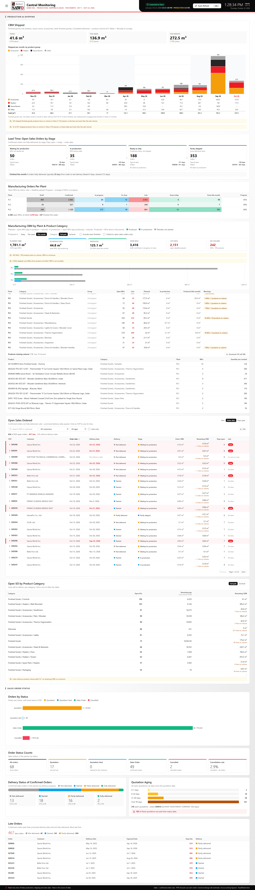

Evidence: the panels are placed on the page by `frontend/src/pages/DashboardPage.jsx`; the "Production & shipping"
panels by `frontend/src/components/operations/OperationsSection.jsx`; the sales panels are in `frontend/src/components/sales/`.
Routes: `frontend/src/App.jsx`. Layout: `frontend/src/layouts/AppLayout.jsx`.

### Which company the data comes from

Odoo contains six companies: **SAWO INC.** (Lapu-Lapu City, Philippines), Sauna World Inc. (Mandaue City, Philippines),
F.E.M. Ltd. (Hong Kong), Bella Vivo Ltd. (Hong Kong), SAWO Nordic Oy (Finland) and Sawo Sauna Europe B.V. (Netherlands).

The Odoo user the dashboard logs in with is allowed to see **only SAWO INC.**, so every sales order, manufacturing
order, delivery and plant on the dashboard belongs to SAWO INC. (checked 21 October 2026).

**Sister companies as customers.** SAWO INC. also produces and sells for the other group companies. About 814 of
SAWO INC.'s ~1,300 sales orders (697 of 1,013 confirmed) have a sister company as the **customer**, mainly Bella Vivo
Ltd. (412) and Sauna World Inc. (365). These orders are SAWO INC.'s own orders, so they are included. You will see
these names in the Customer columns.

**Optional customer scope (server setting, off by default).** `CUSTOMER_SCOPE` in the server's settings file:

| Value | Effect |
|---|---|
| `all` (default) | Every SAWO INC. order, whoever the customer is. |
| `own_company` | Only orders whose customer is SAWO INC. itself (and its contact persons). Sister companies and outside customers are left out. An amber notice on the dashboard says the filter is on. Manufacturing orders are not filtered (they have no customer). |

Tested on 21 October 2026: with `own_company` only about 10 orders and 0.5 m³ of shipments remain, so the
dashboard is almost empty. It is kept off. Evidence: `backend/src/utils/customerScope.js`, `scopeDomain()` in
`backend/src/services/odooService.js`.

---

## Opening the dashboard

| How it runs | Address | Notes |
|---|---|---|
| **Docker** (for other PCs and the wall monitors) | `http://<IP address of the PC running Docker>:8011` | Start with `docker compose up -d --build` in the project folder. Only the screen (port 8011) is reachable from the network; the server part is not. See *Docker_Guide.pdf*. |
| **Development** (the developer's PC) | `http://localhost:5173` | Started with `npm run dev` in `frontend` and `backend`. |

- **"localhost" only works on the PC itself.** Other people must use that PC's network address (for example
  `http://172.16.1.137:8011`), be on the same office network, and the PC must stay on.
- **The address can change** after a restart. For the wall monitors, ask IT to reserve a fixed address for the PC.
- **After a code change**, the Docker version shows it only after `docker compose up -d --build`.
- **After every restart**, the first copy of the production data from Odoo takes about 3 minutes. Until then the
  panels show "Loading…".

---

## Common elements (on every screen)

### Header (top band)

File: `frontend/src/components/Header.jsx`

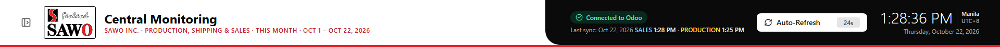

| Element | What it shows |
|---|---|
| Menu button | At the far left. Opens and closes the side menu (see below). |
| Logo and title | "Central Monitoring", the company name from Odoo (**SAWO INC.**) and the period shown (always **This Month**, e.g. "This Month · Oct 1 – Oct 22, 2026"). |
| Connection status | **Connected to Odoo** (green) · **Connecting…** (amber, first start) · **Odoo update delayed** / **Production update delayed** (amber): the latest copy from Odoo did not finish; the screen keeps the most recent data and tries again by itself · **Data may be outdated** (red): no successful copy for longer than normal · **Backend unreachable** (red): the screen cannot reach the server and keeps showing the last loaded data. |
| Last sync | When the server last copied the data successfully: SALES and PRODUCTION. |
| Auto-Refresh button | Shows the countdown (in seconds) to the next automatic reload and spins ("Refreshing…") while loading. It cannot be clicked on purpose: the wall monitors refresh by themselves. |
| Clock | Current time with seconds, timezone (Manila, UTC+8) and date. |

### Side menu and Display mode

File: `frontend/src/components/Sidebar.jsx`, `frontend/src/context/DisplayProvider.jsx`

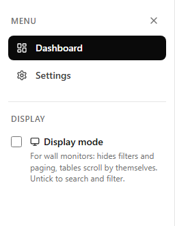

- **Menu:** Dashboard, Settings and Consolidation Order.
- **Display mode** (tick box): for wall monitors. It hides filters and paging in Open Sales Ordered (only the first
  10 orders are shown), and some tables scroll slowly by themselves: they pause when the mouse is over them.
- The choice is remembered **per browser**, so each wall-monitor PC keeps its own setting after a restart.
  The menu is hidden by default.

### Footer (bottom band)

A reminder of the rules: read-only view, Odoo is the source of data, sales = confirmed orders only, PHP amounts use
each order's stored exchange rate (an estimate, not accounting figures), Manila time.

### Refresh behaviour (applies to every dashboard)

| What | How often | Where it is set |
|---|---|---|
| Screen asks the server for new numbers (no page reload) | every **30 s**, skipped while the previous load is still running | `VITE_REFRESH_INTERVAL_SECONDS` |
| Server copies **sales order** data from Odoo | waits `SYNC_INTERVAL_SECONDS` (30 s) after each copy; a copy takes about 30 s | `backend/src/services/syncService.js` |
| Server copies **production & shipping** data from Odoo | waits `OPERATIONS_SYNC_INTERVAL_SECONDS` (120 s) after each copy; a copy takes about 2–3 minutes | `backend/src/services/operationsSyncService.js` |
| While the server is still doing its first copy | the screen re-asks every 5 s | `frontend/src/components/Header.jsx` |

In practice: a change in Odoo appears on screen within about **1–1.5 minutes** for sales orders and **4–6 minutes**
for manufacturing orders and deliveries.

### Loading, empty and error states

File: `frontend/src/components/AsyncContent.jsx`

- **Loading…** with a spinner: the first load is still running.
- **Could not load this data**: there is no data yet and the request failed.
- **Could not refresh (…). Showing the last loaded data.** (amber bar): a refresh failed, so the panel keeps the last good numbers.
- **No data for this period** (or a panel-specific text, e.g. "No late orders."): there is nothing to show.

### Period

There are no global filters. Panels marked "this period" use **This Month** (1st of the month to today, Manila time),
which moves on by itself after midnight. Some panels deliberately show **all** open records regardless of date; each
panel below says which.

---

## Part 1: Production & shipping

### Section purpose

This section answers: **"How much are we shipping, what is it made of, where are the open orders in the process,
how is manufacturing going, and what is still to be delivered?"** It is the client's main focus.

**How "plant" is decided.** A plant is an Odoo **warehouse** (Plant 1 = PL1, Plant 2 = PL2, Plant 3 = PL3,
Plant 4 = PL4, Warehouse 4 = WH4). Each delivery line and manufacturing order belongs to the warehouse of its
**operation type**. Evidence: `warehouseOf()` in `backend/src/services/operationsService.js`.

**What the server reads.** Odoo holds too much history to copy every time (about 30,000 manufacturing orders and
806,000 stock moves). The server reads **open** records, records **completed since the start of this week or month**,
and, for the CBM chart, the **shipped delivery lines of the last 12 months** (`fetchOperationsData()` in
`backend/src/services/operationsService.js`).

**Finished goods.** A product is a "finished good" when its Odoo product category is "All / Finished Goods" or below it.

---

#### Dashboard 1: CBM Shipped

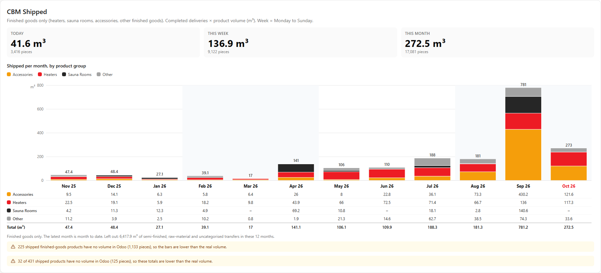

- **Components:** `frontend/src/components/operations/CbmPanel.jsx`, chart `CbmShippedChart.jsx`
- **Server:** `GET /api/operations/cbm-shipped` (cards) and `GET /api/operations/cbm-shipped/monthly` (chart) →
  `cbmShipped()` and `cbmShippedMonthly()` in `backend/src/services/operationsAnalytics.js`

**What it shows**
- Three cards: **Today**, **This week**, **This month**, each in cubic metres (m³) with the number of pieces.
- **Shipped per month, by product group**: one stacked bar per month for the last 12 months (oldest left,
  current month right, shown in red because it is month to date). Each bar is split into **Accessories** (amber),
  **Heaters** (red), **Sauna Rooms** (black) and **Other** (grey); the total is written above the bar.
- Under the chart, a table with the same values per month and group (a dash means 0), and the total per month.
- Hovering over a bar shows the month, every group's CBM and the total.
- Notes: how much non-finished-goods volume was left out, and how many products have no volume in Odoo.

**How it is calculated**
- CBM = delivered quantity × the product's volume (m³), over **completed** outgoing delivery lines in Odoo.
- **Finished goods only** (confirmed by the client's manager on 22 October 2026). Semi-finished goods, raw materials
  and uncategorised items are not counted, in the cards and in the chart.
- The month (and day / week) is the date the delivery line was **completed (validated) in Odoo**, in Manila time.
  "This week" = Monday to Sunday. The chart's current month always equals the "This month" card.
- Groups (from the client's "Composition" list; `backend/src/config/categoryGroups.js`, `SHIPPED_GROUPS`):

| Group | Odoo product categories |
|---|---|
| Accessories | All / Finished Goods / Accessories (and below: doors, pails, sauna stones, sandtimers, thermo-hygrometers…) |
| Heaters | All / Finished Goods / Heaters, / Steam (steam generators), / Controls |
| Sauna Rooms | All / Finished Goods / Sauna Rooms (and below) |
| Other | Every other finished good: spare parts, panels & timbers, marketing material, infrared, finished goods without a sub-category |

- Products without a volume in Odoo count as **0 m³**, so the totals are a **minimum**.

**Odoo data used**

| Model | Fields | Filter |
|---|---|---|
| `stock.move` (delivery lines) | `date`, `quantity`, `product_id`, `picking_type_id`, `picking_id` | `state = done`, `picking_code = outgoing`, last 12 months |
| `product.product` | `categ_id`, `volume`, `uom_id` | products on those lines (kept in a cache between copies) |

**Known limits**
- **Late validation in Odoo moves volume between months.** September 2026 shows about 781 m³, while the client's
  shipment schedule (Excel "Wkly Shipped CBM & LT", based on the actual loading date) shows about 414 m³. About
  325 m³ of it was loaded between January and August but only validated in Odoo in September (for example S04781,
  loaded in January, validated on 24 September). Earlier months are too low for the same reason. Odoo has no
  "actual loading date" field. Details: *September 2026 Shipped CBM Check.pdf*.
- Finished goods moved between SAWO's own plants (to "Inter-warehouse transit") still count as shipped.
- Some shipped products have no volume in Odoo (shown in the notes).

---

#### Dashboard 2: Lead Time: Open Sales Orders by Stage

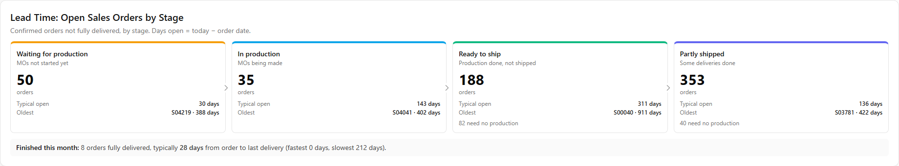

- **Component:** `frontend/src/components/operations/LeadTimePanel.jsx`
- **Server:** `GET /api/operations/lead-time` → `leadTime()` and `stageOf()` in `backend/src/services/operationsAnalytics.js`

**What it shows:** four boxes, left to right, one per stage an open sales order goes through:

| Box (top colour) | Meaning |
|---|---|
| **Waiting for production** (amber) | MOs exist, but none has started |
| **In production** (blue) | At least one MO is in progress or to close, or some MOs are done and others not |
| **Ready to ship** (green) | Every MO is done, or the order needs no manufacturing; nothing shipped yet |
| **Partly shipped** (indigo) | Some deliveries are done (Odoo delivery status "partial") |

Each box shows the **number of orders**, the **typical days open** (median), the **oldest order**, and how many
**need no production**. Underneath: **Finished this month** (orders fully delivered this month and their typical
order-to-last-delivery time).

**How it is calculated**
- Open sales order = confirmed (`state = sale`) and **not fully delivered** (`delivery_status ≠ full`). All dates.
- Days open = today − order date (Manila dates). Cancelled MOs are ignored. "Typical" = **median**.
- Orders without a delivery status in Odoo (for example service-only orders) are left out.

**Odoo data used:** `sale.order` (`name`, `date_order`, `partner_id`, `warehouse_id`, `delivery_status`,
`mrp_production_ids`), `mrp.production` (`state`), `stock.picking` (`sale_id`, `date_done`, `picking_type_id`).

**Known limits:** some open orders are more than 2 years old; they look like records never closed in Odoo.

---

#### Dashboard 3: Manufacturing Orders Per Plant

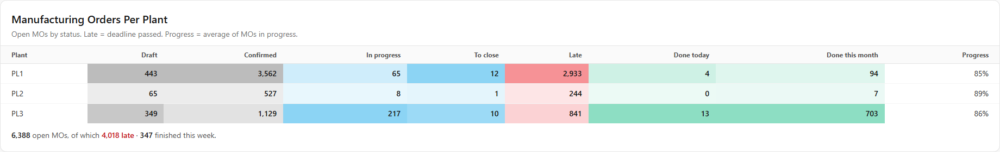

- **Component:** `frontend/src/components/operations/ManufacturingPanel.jsx`
- **Server:** `GET /api/operations/manufacturing` → `manufacturingByPlant()` in `backend/src/services/operationsAnalytics.js`

**What it shows:** one row per plant.

| Column | Meaning | Cell shading |
|---|---|---|
| Draft, Confirmed | Open MOs not started | grey |
| In progress, To close | MOs being made, or made but not yet closed | blue |
| Late | Open MOs whose **deadline** has passed | red |
| Done today, Done this month | MOs finished in that period | green |
| Progress | Average % made over MOs **in progress** | none |

Underneath: total open MOs, how many are late, how many finished this week.

**How it is calculated:** open MO = Draft, Confirmed, In progress or To close. Late = deadline (`date_deadline`)
before now. Progress = quantity producing ÷ quantity to produce (max 100%), averaged. Done = state Done with a finish
date (`date_finished`) in the period (Manila time).

**Known limits:** many open MOs are past their deadline, which suggests old records not closed in Odoo.

---

#### Dashboard 4: Manufacturing CBM by Plant & Product Category

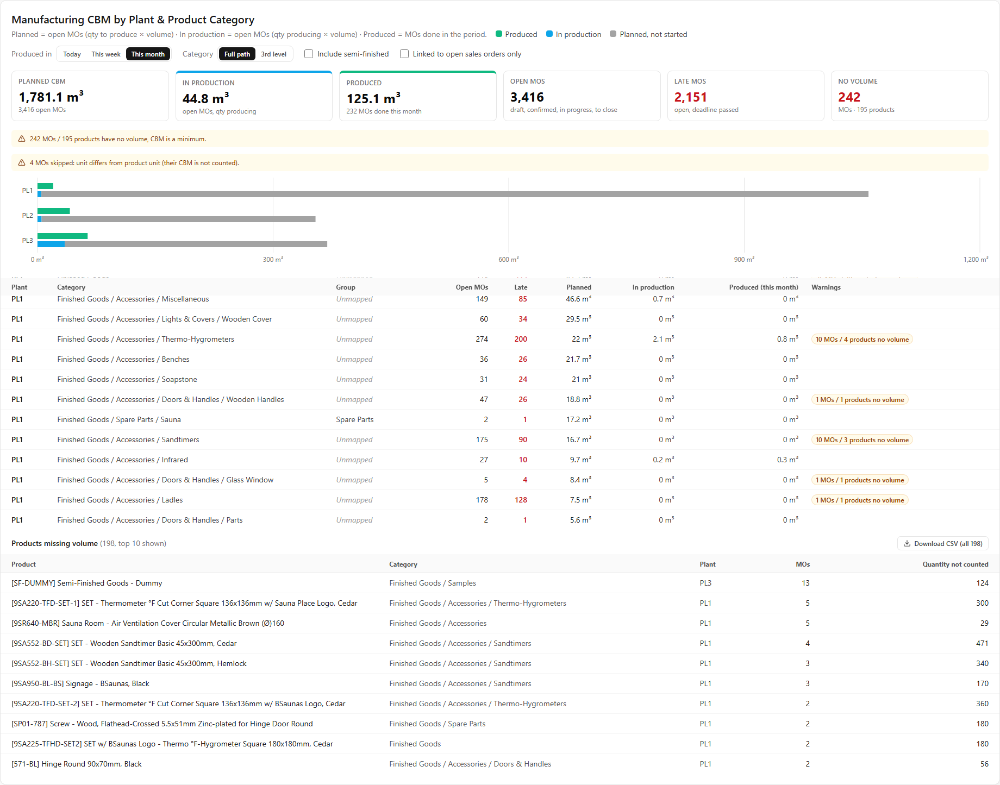

- **Component:** `frontend/src/components/operations/MoCbmPanel.jsx` (directly below "Manufacturing Orders Per Plant")
- **Server:** `GET /api/operations/mo-cbm`, `GET /api/operations/mo-cbm/missing-volume.csv` → `manufacturingCbm()` in
  `backend/src/services/manufacturingCbm.js`

**What it shows**
- Cards: Planned CBM · In production · Produced (in the chosen period) · Open MOs · Late MOs · MOs without volume.
- A bar per plant: produced (green) next to the open MOs (in production blue, planned not started grey).
- A table per plant × category: Open MOs, Late, Planned, In production, Produced, with warning badges. It scrolls by itself.
- "Products missing volume": top 10 on screen, all of them in the CSV.
- Filters: Produced in Today / This week / This month · Category: full path or 3rd level · Include semi-finished
  (off by default) · Linked to open sales orders only.

**How it is calculated**
- Planned CBM = open MO quantity to produce × product volume. In production = quantity producing × volume.
  Produced = done MO quantity × volume, finished in the chosen period. Cancelled MOs never count.
- Finished goods only by default; semi-finished can be added with the switch.
- MOs whose unit differs from the product's unit are skipped and counted in a warning.

---

#### Dashboard 5: Open Sales Ordered  ·  Open SO by Product Category

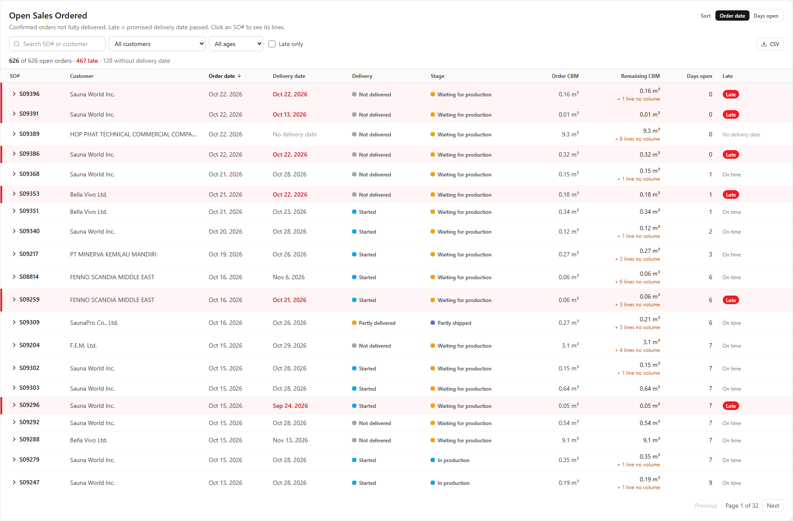

- **Components:** `frontend/src/components/operations/OpenOrdersSection.jsx` (shared filters) →
  `OpenOrdersPanel.jsx` (table) and `OpenOrdersByCategoryPanel.jsx` (board)
- **Server:** `GET /api/operations/open-orders`, `/open-orders.csv`, `/open-orders/by-category`,
  `/open-orders/:id/export.xlsx` → `backend/src/services/openOrders.js`, `backend/src/services/orderExport.js`
- **No money** in the table, the board or the CSV.

**Open Sales Ordered (table)**
- One row per open order: SO# · **Destination** · Customer · Order date · **Delivery date** · Delivery status · Stage ·
  Order CBM · Remaining CBM · Days open · Late. Late rows are red.
- **Destination** = the country of the order's **Delivery Address** in Odoo (`partner_shipping_id` → country), e.g.
  "United Arab Emirates". It often differs from the customer's country (e.g. orders for Bella Vivo, Hong Kong, shipped
  to the Netherlands). "—" when the delivery address has no country. Not in the CSV.
- Search (SO#, customer or destination), customer, age (0–30 / 31–90 / 91–365 / over 365 days), late only; quick sort buttons
  **Order date** / **Days open** (column headers also sort); 20 rows per page; **CSV** of all matching rows.
- In Display mode the controls are hidden and the first 10 orders are shown.

**Delivery date.** The value of the **"Delivery Date"** field on the Odoo sales order (`commitment_date`). Example:
S09259 shows Oct 21, 2026, the same as in Odoo. "No delivery date" when it is empty. An order is **Late** when this
date has passed.

**Order lines (click the SO#)**

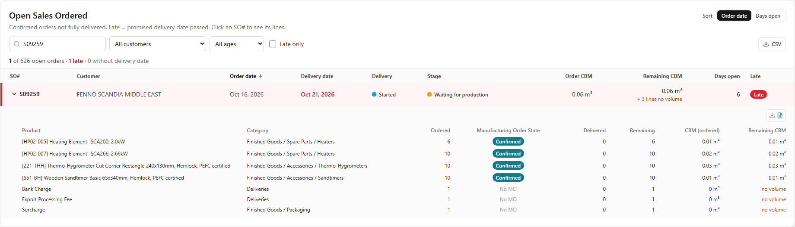

| Column | Meaning |
|---|---|
| Product, Category | The product on the order line and its Odoo category |
| Ordered | Quantity ordered |
| **Manufacturing Order State** | The state of every manufacturing order (MO) for this product and order, as a badge: **Done** (green), **Confirmed** (teal), In Progress / To Close (amber), Draft (grey), Cancelled (light grey). When a line has several MOs in the same state the badge shows a count (e.g. "Done ×2"); hovering shows the MO numbers. **No MO** when there is none (e.g. fees). |
| Delivered, Remaining | Quantity delivered and still to deliver |
| CBM (ordered), Remaining CBM | Odoo's line CBM, and remaining quantity × product volume |

How MOs are linked to an order line: same **product**, and the MO is either linked to the sales order in Odoo, or
its **Source** field mentions the order reference ("S09259" or "SO9259"; "PO#9259" does not count). About 3,150 MOs are
linked only through their Source. Evidence: `originMentions()` and `buildOpenOrders()` in `backend/src/services/openOrders.js`.

**Download Excel (one order).** The small download button above the order lines creates an Excel file of that order,
laid out like the client's sample **"SO 9259.xlsx"** (file name "SO 9259.xlsx"):

| Sheet | Content |
|---|---|
| SO Overview | SO Number, Status, Order Date (Odoo, UTC), Customer, Delivery Address, Pricelist, Payment Terms, Total Amount (in the order's own currency) |
| Delivery Address | Name, Street, City, Country, Email, Internal Note |
| Order Lines | #, Product Reference, Product Name, Qty, Total CBM, and a TOTAL row |
| Log Messages | Date, Author, Type, Message, Attachments (number) from the order's Odoo chatter |

The file is built by our server from a read-only read of that one order; nothing is written to Odoo. Money appears
**only in this file**, not on the dashboard. Checked in Excel against the sample on 21 October 2026: same values,
fonts, colours and column widths.

**Open SO by Product Category (board)**

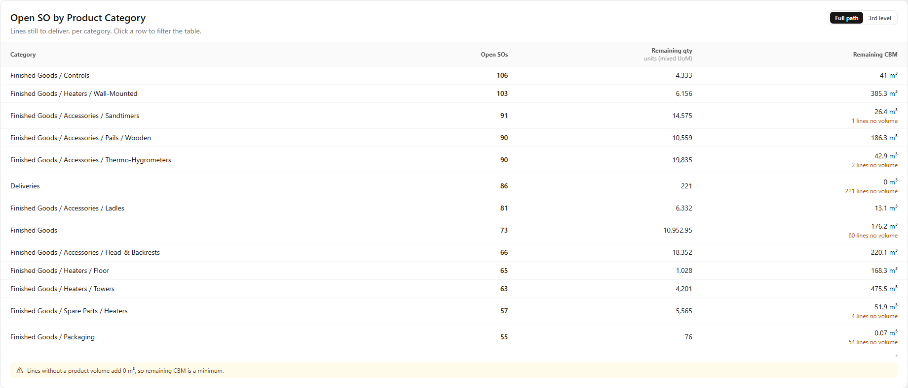

- Category · Open SOs · Remaining qty · Remaining CBM. Full path or 3rd level. Clicking a row filters the table.
- In Display mode the list scrolls by itself.

**How it is calculated**
- Open order = `state = sale` AND `delivery_status` set and not `full`.
- Order CBM = Odoo's `sale.order.total_cbm`. Remaining CBM = Σ (ordered − delivered) × product volume; lines without
  volume add 0 m³, so it is a minimum.
- Days open = today − order date (Manila dates).

**Odoo data used:** `sale.order` (+ `commitment_date`, `total_cbm`, `mrp_production_ids`), `sale.order.line`
(`order_id`, `product_id`, `product_uom_qty`, `qty_delivered`, `total_product_cbm`), `mrp.production` (`name`,
`state`, `product_id`, `origin`), `product.product` (`categ_id`, `volume`). For the Excel file also: `res.partner`
(delivery address), `sale.order` (`pricelist_id`, `payment_term_id`, `amount_total`) and `mail.message` (chatter).

---

## Part 2: Sales order status

### Section purpose

This section answers: **"Where do our sales orders stand: how many are quotations, confirmed or cancelled, how far
have confirmed orders been delivered, which quotations are getting old, and which orders are late?"**

Apart from the PHP values on "Orders by Status", **all panels show counts only, no money**.

| Uses **This Month** (orders dated this month) | Uses **all open records** (the current backlog) |
|---|---|
| Orders by Status · Order Status Counts · Delivery Status of Confirmed Orders | Quotation Aging · Late Orders |

**Rules used in every panel**
- Odoo status → label: `draft` = **Quotation**, `sent` = **Quotation Sent**, `sale` = **Sales Order** (confirmed), `cancel` = **Cancelled**.
- An order belongs to "this month" by its **order date**, converted from Odoo's UTC time to Manila time.
- Delivery status → label: `pending` = **Not delivered**, `started` = **Started**, `partial` = **Partly delivered**, `full` = **Fully delivered**.

---

#### Dashboard 6: Orders by Status

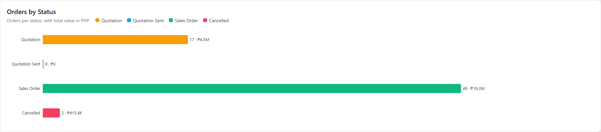

- **Server:** `GET /api/dashboard/order-status` · **Period:** This Month
- One bar per status: the length is the **number of orders**; the label shows the count and the total value in PHP
  (`amount_total ÷ currency_rate`, each order's own stored rate; an estimate). Quotation and cancelled values are for context only.

---

#### Dashboard 7: Order Status Counts

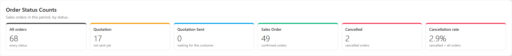

- **Server:** `GET /api/dashboard/status-counts` · **Period:** This Month
- Six cards: All orders, Quotation, Quotation Sent, Sales Order, Cancelled, **Cancellation rate** (cancelled ÷ all × 100).

---

#### Dashboard 8: Delivery Status of Confirmed Orders

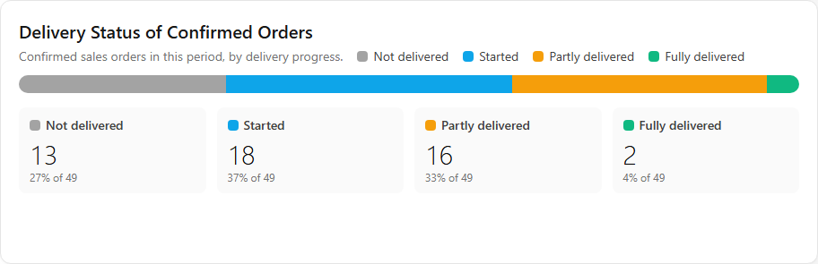

- **Server:** `GET /api/dashboard/delivery-status` · **Period:** This Month
- One bar split by delivery status of this month's **confirmed** orders, with counts and percentages underneath.

---

#### Dashboard 9: Quotation Aging

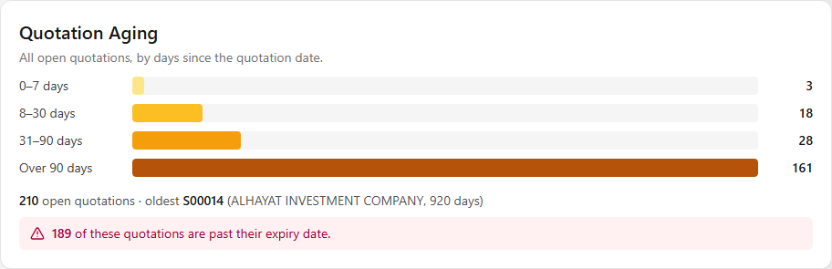

- **Server:** `GET /api/dashboard/quotation-aging` · **Period:** all open quotations
- Bars by age (0–7, 8–30, 31–90, over 90 days), the oldest quotation, and how many are past their expiry date
  (`validity_date`). Many old quotations look like records never cancelled in Odoo.

---

#### Dashboard 10: Late Orders

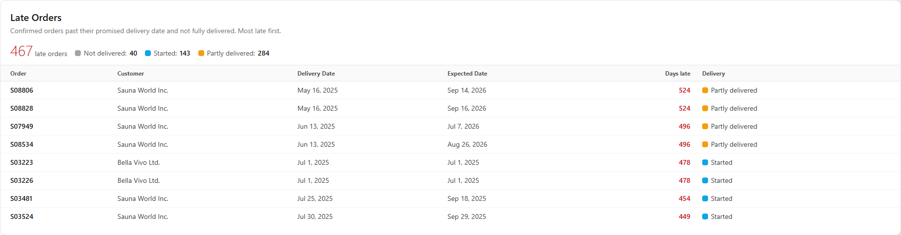

- **Component:** `frontend/src/components/sales/LateOrdersPanel.jsx`
- **Server:** `GET /api/dashboard/late-orders?limit=8` → `lateOrders()` and `withExpectedDate()` in `backend/src/services/orderStatusAnalytics.js`
- **Period:** all confirmed orders (the current backlog)

**What it shows:** the total number of late orders and how many are Not delivered / Started / Partly delivered; a
table of the **8 most late** orders: Order · Customer · **Delivery Date** · **Expected Date** · Days late · Delivery status.

| Column | Odoo field | Meaning |
|---|---|---|
| Delivery Date | `commitment_date` ("Delivery Date" on the sales order) | The promised delivery date. Used to decide whether an order is late and how many days late. |
| Expected Date | `expected_date` ("Expected Date", calculated by Odoo) | Odoo's own expected date from the order's lines and deliveries. Shown for information only; "—" when Odoo has none. |

**How it is calculated:** late order = confirmed, has a Delivery Date **before now**, and is **not fully delivered**.
Days late = today − Delivery Date (Manila days). Most late first.

**Known limits:** many late orders are more than a year late and look like orders delivered or closed outside the
normal Odoo flow. Orders without a Delivery Date are never counted as late.

---

## Consolidation Order

Screen `/consolidation` (side menu, below Settings). It is **not** part of the wall-monitor view: it is a working page for planning what has to be made and shipped.

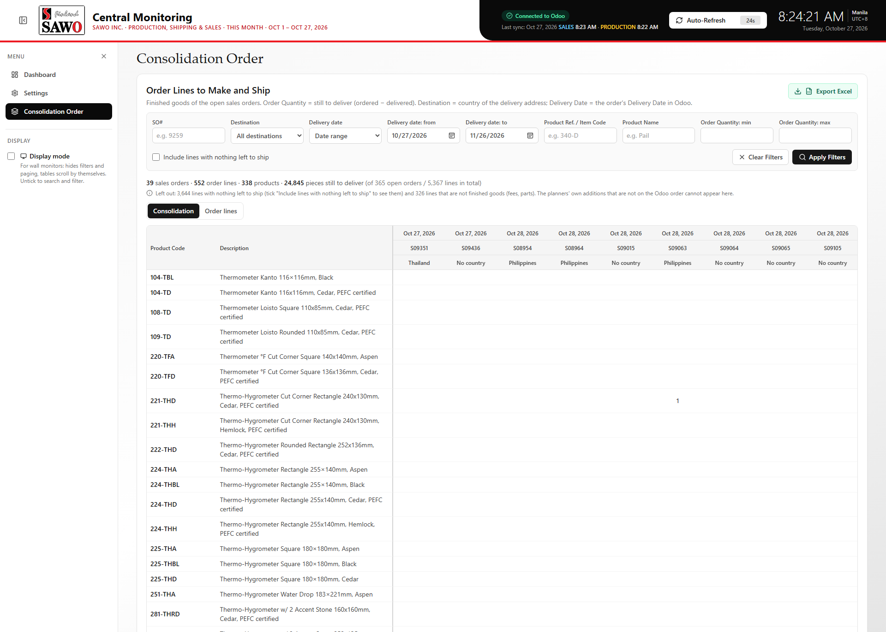

- **Files:** frontend `frontend/src/pages/consolidationOrder/`, server `backend/src/pages/consolidationOrder/` (each folder has a README for developers).
- **Server:** `GET /api/consolidation/lines`, `/matrix`, `/export.xlsx`. The page adds **no Odoo requests**: it calculates from the open sales orders and order lines that the production sync already copied.

**What it shows.** The lines of the **open sales orders** (confirmed, not fully delivered) that are **finished goods**, with the quantity **still to deliver** (ordered − delivered). Fully delivered lines and fees/parts are left out; the page says how many.

**Filters** (all work together; press **Apply Filters**, or **Clear Filters** to remove them all):

| Filter | What it does |
|---|---|
| SO# | One or more SO numbers, shown as chips (type and press Enter, or separate with commas / new lines, or paste a list; duplicates are ignored, the x on a chip removes it). "SO 9259", "SO9259" and "S09259" find exactly that order; other text ("9259") finds every SO number containing it. Any of the listed SO numbers matches; the other filters still apply on top. |
| Destination | Dropdown of the countries that appear (country of the order's Delivery Address) |
| Delivery date | A dropdown: **Date range** (default; the from / to dates below it, strict: nothing outside them appears), **Date range + no delivery date (TBA)** (the same range plus the orders that have no date), **Overdue** (Delivery Date before today), **Only no delivery date (TBA)**, or **Any date**. Starts as **today to 30 days ahead**. |
| Delivery date from / to | The range on the order's Delivery Date (Odoo); only used in "Date range" mode |
| Product Ref. / Item Code | Text inside the product's Internal Reference |
| Product Name | Text inside the product name (can be combined with the code) |
| Order Quantity min / max | Range of the line's remaining quantity |
| Include items made for the order (manufacturing orders) | Also lists finished-goods items that have a manufacturing order for the sales order but are not on the order (for example accessories the planners add to a container). The Order lines tab marks them in a **Source** column ("MO PL3/MO/13552 · Done"); the Excel "Details" sheet has Source, MO and MO state columns. Off by default. Items that are Semi-Finished in Odoo (most of the workbook's extras) are not included. |
| Include lines with nothing left to ship | Also lists the lines of the open orders with nothing left to ship (fully delivered, or an ordered quantity of 0; quantity 0, greyed). They show on the Order lines tab and in the Excel "Details" sheet, not in the Consolidation matrix. Orders that are completely closed are not in the production data. |

**Two views (tabs)**
- **Consolidation:** like the sheet "Consolidation FG" of the workbook: products down the side (code, Description, **Product Category**), one column per sales order (Delivery Date, SO#, Destination on top; "TBA" first when there is no date), quantities in the cells, **Grand Total** column and row. Up to 60 orders side by side; with more it asks to narrow the filters.
- **Order lines:** like the sheet "Sheet4": one row per order line (SO#, Destination, Product Ref., Product Name, **Product Category**, Delivery Date, Ordered, Delivered, **Order Quantity**), sortable on every column, paged.

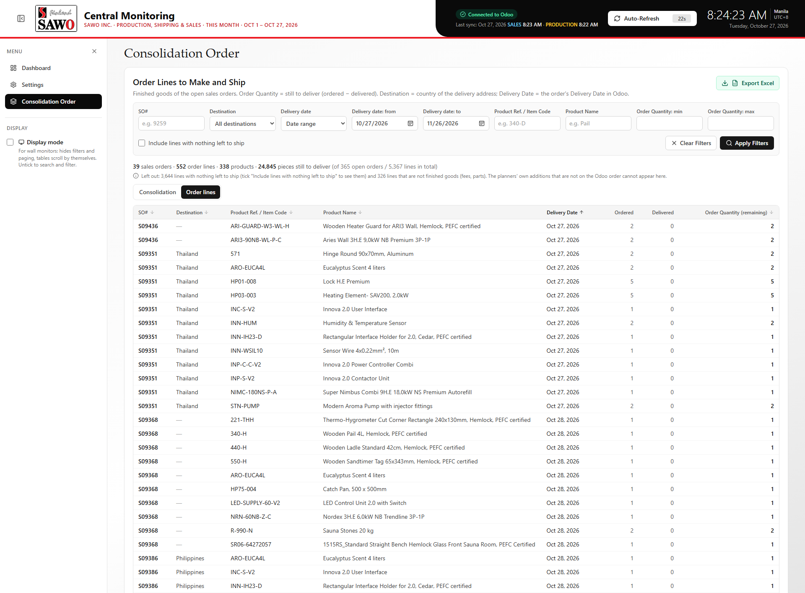

**Product Category:** read from the product's category in Odoo and named by the same rule as the CBM Shipped chart: Accessories, Heaters (Heaters, Steam and Controls) and Sauna Rooms; any other Odoo category keeps its own name (for example "Packaging"), and "No category" is shown when a product has none. Hovering a category shows its full Odoo path. It is also a column in the Excel export.

**Export Excel** (`Consolidation_Order_YYYY-MM-DD.xlsx`): the data of the current filters. Sheet **"Consolidation FG"** copies the layout of the workbook's sheet (header rows, thin borders, green Grand Total with SUM formulas, green tab) and sheet **"Details"** lists the lines with a filter on the header. Checked in Excel against the sample on 27 October 2026: same fonts, borders, widths, fill colour and hidden column; the SUM formulas recalculate to the same numbers. Differences: the sample's typo "Desciption" is written "Description", the headers are bold, and the destination is the Odoo country.

**Where the values come from (Odoo, read-only)**

| Workbook column | Odoo |
|---|---|
| so # | `sale.order` name |
| Destination | `sale.order.partner_shipping_id` → country (the planner's short names such as HALU or SSE cannot be reproduced) |
| Completion Date | `sale.order.commitment_date` (the Delivery Date) |
| Product Code / Desciption | `product.product` `default_code` / `name` |
| Qty | `sale.order.line` `product_uom_qty` − `qty_delivered` (remaining) |

**Known limits.** The workbook is a planner's selection: it also holds items that are not on the Odoo order, quantities chosen for a container, and rows without an SO number. In a comparison of 17 orders the Excel quantity equalled Odoo's in about 60% of the product rows. Only what Odoo knows can appear here. Some "TBA" orders have an old date in Odoo.

---

## Other screens

| Address | Screen | Status |
|---|---|---|
| `/settings` | **Settings** (also in the side menu): the panel **Odoo Data Sync** (for SALES and for PRODUCTION: how long the last copy from Odoo took, the wait between copies, one full cycle, how old the data is, and an overall **Odoo status**: Smooth / Stable / Starting / Delayed / Outdated / Unreachable), then company, base currency, timezone, connection and the numbers in memory. Read-only. | Built |
| `/consolidation` | **Consolidation Order** (side menu, below Settings), see above | Built |
| `/sales-orders`, `/analytics` | Placeholder pages, reachable only by typing the address | **NOT IMPLEMENTED** |

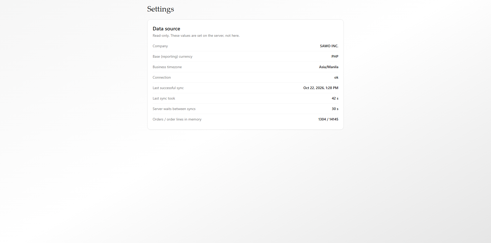

**Not implemented:** global filters (date presets, status, salesperson, customer), a Sales Orders page with order
detail, an Analytics page, and a per-sales-order production status page.

---

## Glossary

| Term | Meaning |
|---|---|
| **SAWO INC.** | The company whose Odoo data the dashboard shows (Lapu-Lapu City, Cebu, Philippines). |
| **Sister company** | Another company of the SAWO group (Sauna World Inc., F.E.M. Ltd., Bella Vivo Ltd., SAWO Nordic Oy, Sawo Sauna Europe B.V.). They appear only as **customers** on SAWO INC. orders. |
| **Odoo** | The company's ERP system; the only source of the data shown here. |
| **Read-only** | The dashboard only reads Odoo data; it never changes anything. |
| **Sync** | The server copying data from Odoo into its memory, on a schedule. |
| **Near-real-time** | Updated within a few minutes, not instantly. |
| **Display mode** | Wall-monitor setting in the side menu: hides filters and paging, tables scroll by themselves. |
| **Sales order (SO)** | A customer order in Odoo (reference like S09259). |
| **Quotation / Quotation Sent** | An offer not yet confirmed (Odoo states `draft` / `sent`). |
| **Confirmed / Sales Order** | An order the customer accepted (Odoo state `sale`). |
| **Delivery status** | How far a confirmed order has been delivered: Not delivered, Started, Partly delivered, Fully delivered. |
| **Delivery Date** | The "Delivery Date" on the Odoo sales order (`commitment_date`): the promised date. Used to decide whether an order is late. |
| **Expected Date** | Odoo's calculated expected date of the order (`expected_date`). Information only. |
| **Late order** | A confirmed order past its Delivery Date and not fully delivered. |
| **MO (manufacturing order)** | An Odoo order to produce a product (`mrp.production`). |
| **MO states** | **Draft**, **Confirmed** (planned, not started), **In progress**, **To close** (made, not closed), **Done**, **Cancelled**. |
| **MO Source** | The "Source" field of an MO in Odoo; often contains the sales order reference. |
| **Plant** | An Odoo warehouse: Plant 1 (PL1), Plant 2 (PL2), Plant 3 (PL3), Plant 4 (PL4), Warehouse 4 (WH4), all in Lapu-Lapu City. |
| **Finished goods** | Products in the Odoo category "All / Finished Goods" or below it. |
| **CBM** | Cubic metres (m³): quantity × product volume. |
| **Shipped** | A delivery line completed (validated) in Odoo. Its date is the validation date, not the container loading date. |
| **Lead time** | Days from the order date to today (open orders) or to the last delivery (finished orders). |
| **Median ("typical")** | The middle value when all values are sorted; not distorted by a few extreme cases. |
| **This week / This month** | Monday to Sunday / the 1st of the month to today, Manila time. |
| **Backlog** | Everything still open today, no matter when it was created. |
